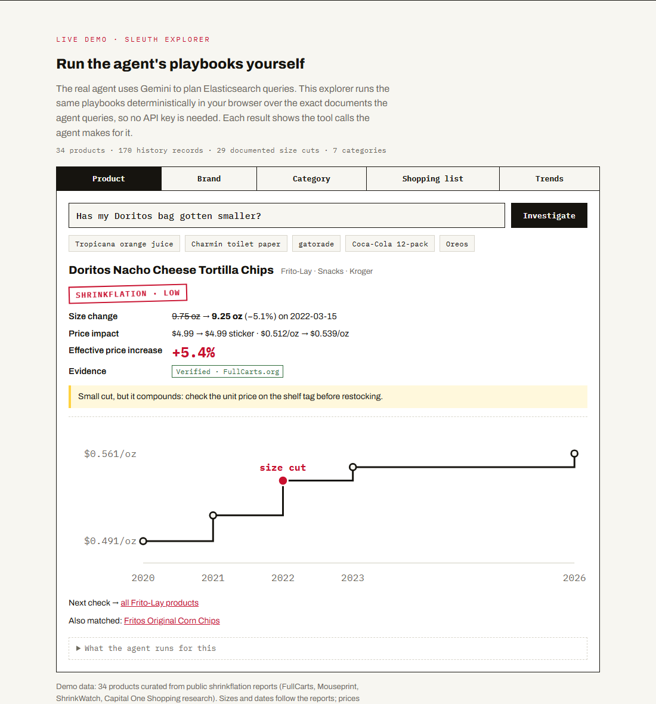
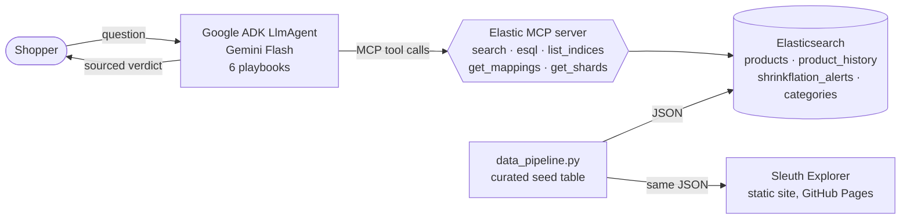

# Shrinkflation Sleuth 🔍

**An AI agent that catches companies quietly shrinking your groceries, and tells you what it's really costing you.**

[](https://github.com/ShawnJoshua03/shrinkflation-sleuth/actions/workflows/ci.yml)
[](LICENSE)
[](https://shawnjoshua03.github.io/shrinkflation-sleuth/)

### ▶ [Live demo](https://shawnjoshua03.github.io/shrinkflation-sleuth/)

[](https://shawnjoshua03.github.io/shrinkflation-sleuth/#explorer)

Built in three days for the [Google Cloud Rapid Agent Hackathon](https://rapid-agent.devpost.com/) (Elastic track) with **Google ADK**, **Gemini**, **Elasticsearch** and the **Elastic MCP server**.

---

## The problem

*Shrinkflation* is when a product gets smaller while the price stays the same. Capital One Shopping research estimates it has touched roughly a third of grocery items. Shoppers notice ("this bag feels lighter"), but nobody can easily answer the one question that matters: **how much more am I paying per ounce?**

## The approach

A multi-step agent that turns that hunch into a number with a source:

1. **Find the product.** It runs a fuzzy full-text search over a product catalog in Elasticsearch.
2. **Pull its size and price history.** It runs ES|QL and computes the price-per-unit at every point.
3. **Cross-check documented events.** It looks up the size change and its source, and flags Reddit-only reports as unverified.
4. **Report.** It returns the size change, the **effective price increase** (the change in price-per-unit, which is the number shrinkflation hides), a severity rating, a consumer tip and one suggested next check.

The agent is a single Google ADK `LlmAgent` with six explicit **playbooks** in its instructions: product lookup, brand investigation, category analysis, shopping-list audit, trend dashboard and data discovery. Gemini picks the playbook for each question. All data access goes through the five read-only Elastic MCP tools: `search`, `esql`, `list_indices`, `get_mappings` and `get_shards`.

### About the live demo

The full agent needs an Elasticsearch cluster and a Gemini API key, neither of which can be hosted publicly for free. So the [live demo](https://shawnjoshua03.github.io/shrinkflation-sleuth/) is a **Sleuth Explorer**: it runs the same playbooks in your browser, without an LLM, over the **exact JSON documents** the agent queries. Each result panel shows the tool calls the agent makes for that question. It's a faithful view of the data and the logic. It is not a chat with the model. To run the real agent, see the [quickstart](#quickstart).

## Results

| | |
|---|---|
| Dataset | 34 products · 16 brands · 7 categories · 170 history records · 29 documented size cuts (24 verified) · 5 unchanged control products |
| Average hidden increase | **+12.2%** price-per-unit across the 29 size cuts (average shrinkage 10.2%) |
| Worst case | Haribo Goldbears: 5 oz → 4 oz at the same $1.99, a **+25%** hidden increase |
| Worst category (verified) | Frozen & Dairy, −14.3% average shrinkage (only 1 verified event). Beverages is next at −13.0% across 3 |
| Tests | 35 pytest tests for the shrinkflation math, dataset invariants, mapping/document consistency, agent wiring and the MCP server |

**Limitations, stated plainly:**
- **No quantitative eval of the agent.** The six query types were only spot-checked by hand. Answer quality and tool-call accuracy were never benchmarked.
- **Demo-scale data.** Sizes, dates and sources follow public reports, but **prices are representative, not live quotes**. Points between documented events are interpolated. See [Data & methodology](#data--methodology).
- **The original Elastic Cloud cluster has been shut down.** To run the agent, load the data into your own cluster with `make index`.
- **The explorer's search** imitates Elasticsearch's `multi_match` with `fuzziness: AUTO`. It isn't Elasticsearch, so edge cases can rank differently.

## Architecture



- **Production topology (Cloud Run):** two services. One runs the official `docker.elastic.co/mcp/elasticsearch` image in HTTP mode. The other runs this repo's FastAPI app (`main.py`), which serves the ADK chat UI and API and reaches MCP via `ELASTIC_MCP_URL`.
- **Local development:** with `ELASTIC_MCP_URL` unset, the agent spawns [`es_mcp_server.py`](agents/shrinkflation_sleuth/es_mcp_server.py) over stdio. It's a roughly 70-line Python MCP server exposing the same five tools, so no Docker is needed.

More detail in [docs/architecture.md](docs/architecture.md).

## Tech stack

| Layer | Tools |
|---|---|
| Agent | Google ADK (`LlmAgent`), Gemini Flash (configurable via `GEMINI_MODEL`) |
| Tools / integration | Model Context Protocol, Elastic MCP server, custom FastMCP server |
| Data | Elasticsearch (query DSL + ES\|QL), Python data pipeline |
| Serving | FastAPI / uvicorn, Docker, Cloud Run, Cloud Build |
| Demo | Vanilla JS + inline SVG, no build step, GitHub Pages |
| Quality | pytest, ruff, GitHub Actions |

## Quickstart

**Just the demo** (no accounts needed):

```bash
git clone https://github.com/ShawnJoshua03/shrinkflation-sleuth && cd shrinkflation-sleuth
make setup        # venv + dependencies
make serve        # http://localhost:8080
```

**The full agent.** Prerequisites: Python 3.11+, an Elasticsearch cluster (an Elastic Cloud trial or a local Docker node), and Gemini access through Vertex AI or an AI Studio API key.

```bash
cp .env.example .env    # fill in ES_URL, ES_API_KEY and Gemini settings
make index              # create the 4 indices and load the data
make agent              # ADK chat UI at http://localhost:8000 → pick "shrinkflation_sleuth"
```

Then ask: *"Has my Doritos bag gotten smaller?"*, *"Show me all shrinkflation from Procter & Gamble"*, *"Check these: Tide, Charmin, Folgers"*.

**Development:** `make test`, `make lint`, `make format`, and `make data` regenerates the datasets deterministically. On Windows, run `make` from Git Bash, or run the commands in the [Makefile](Makefile) directly.

**Deploying the agent to Cloud Run.** This needs a GCP billing account. Deploy the Elastic MCP server first, then the agent:

```bash
gcloud run deploy elastic-mcp --image=docker.elastic.co/mcp/elasticsearch \
  --args=http --port=8080 --region=us-central1 --set-env-vars=ES_URL=...,ES_API_KEY=...
gcloud builds submit --config cloudbuild.yaml   # expects es-url / es-api-key / elastic-mcp-url in Secret Manager
```

## Project structure

```
agents/shrinkflation_sleuth/
  agent.py            root_agent: Gemini + six playbooks + MCP toolset
  es_mcp_server.py    local stdio MCP server (same 5 tools as the official image)
main.py               FastAPI entrypoint for Cloud Run (serves the ADK UI + API)
data/scripts/         data_pipeline.py · create_indices.py · bulk_index.py
data/processed/       generated JSON for the 4 indices (also served to the demo)
frontend/             landing page + Sleuth Explorer (index.html, explorer.js)
tests/                pytest suite
docs/                 architecture notes, original Devpost write-up, screenshots
.github/workflows/    CI (lint + tests) and GitHub Pages deploy
Dockerfile · cloudbuild.yaml · Makefile
```

## What I learned / design decisions

- **One agent with playbooks beat a pipeline of agents.** I first sketched a `SequentialAgent` (lookup → analyze → report). That forces every question through a product lookup, which is wrong for "which category is worst?" or "what data do you have?". A single `LlmAgent` with explicit multi-step playbooks has fewer moving parts and no agent-handoff failures, and the tool sequence is still visible in the trace.
- **Agent quality is mostly instruction quality.** Real multi-step behaviour came from writing playbooks where each step's output is required by the next. For example, the `product_id` from `search` feeds both the ES|QL history query and the alert lookup. I also gave explicit error paths: zero hits, missing history, and an ES|QL syntax error that gets one retry with a simpler query.
- **ES|QL suits agent analytics.** A single `STATS ... BY category` call replaces several aggregation round trips. That keeps the agent's plans short and its answers grounded in tool output ("never invent sizes, prices, or dates").
- **Report the right metric.** Sticker price hides shrinkflation, and price-per-unit exposes it. Every answer leads with the *effective* price increase, which is always larger than the shrinkage percentage when the price holds steady.
- **MCP made the data layer swappable.** The same agent talks to the official Elastic MCP image over HTTP in production and to a small Python MCP server over stdio locally. Only the connection parameters change.
- **Make the demo honest, not impressive.** I couldn't host a public LLM endpoint for free without exposing a key. So the demo runs the same logic deterministically over the same data and says so, rather than faking a chat.
- **Reproducibility bugs hide in plain sight.** The pipeline was documented as deterministic, but it derived UPCs from Python's per-process salted `hash()`. A test now regenerates the data and fails if the committed files have drifted.

## Data & methodology

The dataset is curated from publicly documented shrinkflation reports: FullCarts.org, ShrinkWatch / ShrinkSpotter, Mouseprint.org and Capital One Shopping research, with BLS downsizing data for context. Entries sourced only from r/shrinkflation are marked `verified: false`. Prices are representative retail prices around the time of each change, not a live feed. Full details and caveats are in [data/README.md](data/README.md).

## Disclaimer

For informational and educational purposes only. It is not financial or consumer-purchasing advice. Prices are illustrative. Product and brand names are trademarks of their respective owners and appear only to describe publicly reported package-size changes. This project is not affiliated with or endorsed by any brand, retailer, Google or Elastic.

## License

[Apache 2.0](LICENSE)
